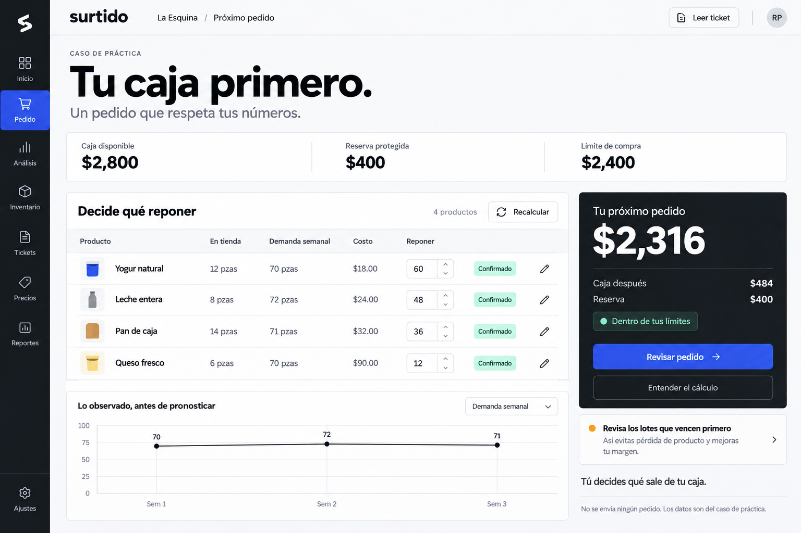
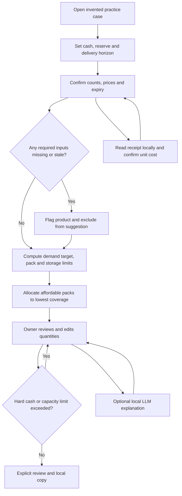
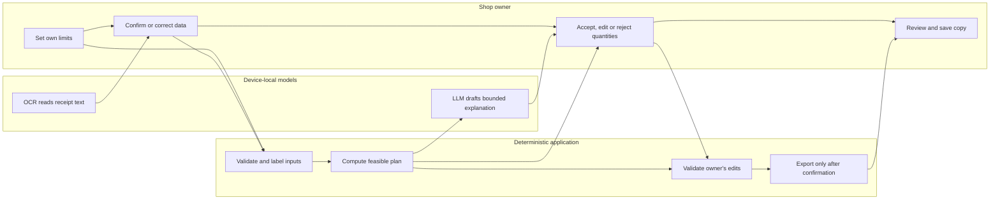

# SURTIDO - Business Bending / Week 10 / MONEY

Packet completed before application code. 14 October 2026, America/Mexico_City.
Owner: Rodrigo Peña de León Pérez. Individual declaration: cash-limited replenishment for one perishable category, counting waste and stockouts. The team chose a different primary experiment; its Blueprint explicitly allows this surviving individual slice.

## 1. Problem, exact user and moment

A neighborhood shop owner must decide the next supplier order using a cash reserve, current stock, short sales history, capacity, expiry and purchase packs. More stock is not automatically better. A recommended quantity should be understandable, editable and comparable with buying nothing or adopting an existing inventory product.

Elena, 54, is the hypothetical owner of Tiendita La Esquina. She handles a phone, recognizes products by name, distrusts unexplained alerts and will abandon a long setup. This is a design persona, not an interview. The educational app contains only invented store data; there are no real customer profiles or accounts.

The entry moment is the supplier visit: set cash and reserve, confirm the count and cost, inspect a bounded order, change quantities if necessary, and explicitly save a private copy. The application never sends an order, pays, lends, ranks suppliers or predicts business success.

## 2. Success before the module closes

A live URL opens a usable Spanish workflow. Four example perishable SKUs provide enough interaction to test the category slice. A plan respects cash after the reserve, storage and pack sizes; stale or unconfirmed inputs are excluded visibly. A receipt image is actually read locally by OCR, and unit cost is proposed for human confirmation, not silently treated as a total or a delivery. A real local LLM can explain an already computed plan without changing quantities; unavailability is labeled and rules remain usable. Editing a constraint invalidates prior explanations and saved-plan confirmation. A reviewed order can be downloaded or printed without sending it to a supplier.

A numerical lab reproduces the Brain's illustrative yogurt comparison: benefit MX$992, initial cost MX$213, net MX$779 and gross benefit/cost 4.66:1. It explicitly labels these as assumptions and does not apply them to the current product table or claim measured savings.

## 3. Image-generated mockup and design handoff

The user explicitly requested a premium startup aesthetic. The final reference was generated with Imagegen before coding: charcoal navigation rail, near-white workspace, cobalt primary action, precise large numerals and a restrained product table. No shop cartoons, AI sparkles, gradients or brand product packaging. The image is a hierarchy reference; its illustrative numbers are not a validated calculation. Source for implementation numbers is the domain model, not pixels in the mockup.

Desktop: rail + topbar; task title; editable financial strip; product table and an order summary; provenance and useful explanations. Mobile: short navigation and stacked product cards, always showing the remaining purchase limit. See DESIGN_SYSTEM.md for tokens and component states. All controls have labels, keyboard focus, 44px hit areas, error text and readable contrast.

## 4. Flow and actor responsibilities

## 5. Benchmark and GLOBAL → LOCAL

The best existing general inventory option considered here is Loyverse: basic inventory is free and purchase-order capabilities already exist in its paid advanced inventory tier. Surtido's proposed difference is one low-setup cash-reserve decision with clear uncertainty, not another general POS. Treinta already offers Mexican inventory and expense workflows; its commerce FAQ requires internet, so lack of tools in Mexico is not our claim. Jumbotail demonstrates the connection between kirana ordering, physical supply and financing; its supplier network cannot be imported by translating an app.

Local adaptation hypothesis: Spanish product names, MXN arithmetic, explicit cash reserve, supplier packs and short owner-confirmed inputs. A ready-made product wins if it solves the task with less effort. No adoption or performance advantage has been established.

Sources reviewed in the Brain: https://loyverse.com/advanced-inventory ; https://treinta.co/mx/comercios ; https://jumbotail.com/ . Product descriptions do not prove results in our case.

## 6. Long view

In three years a validated version could connect a shop's existing ledger with neutral purchasing decisions across suppliers. It would preserve owner control, source labels, permission boundaries and a clear separation between advice and transactions. Expansion would require real baseline data, observed adoption, paid support economics and authenticated per-shop records before storing any personal information.

## 7. Scope cut

No storefront, consumer recommendation engine, checkout, payments, credit, supplier ranking, customer profiling, bank feeds, WhatsApp integration or forecasts presented as guarantees. No real personal data or account database. No supplier email or automatic order. No global POS replacement, cross-device sync or production onboarding. No guarantee of demand, expiry, savings, fit-to-customer or 10:1 economics.

## 8. Domain rules and uncertainty

Money uses integer centavos. Purchase budget = cash minus reserve; both are owner-defined and must be finite nonnegative values within documented bounds. Sales history has three example weekly observations. Mean daily sales provides a labeled planning proxy; observed stockouts can hide demand. Desired stock = mean daily sales × owner horizon × (1 + safety buffer). Replenishment subtracts confirmed stock, rounds to supplier packs and is capped by storage and the new lot's declared saleable life. Expired current units are not saleable; near-expiry units require separate confirmation, not an assumed zero balance.

When total desired purchases exceed the cash budget, allocate one affordable pack at a time to the eligible product with the lowest days of coverage; resolve ties by fixed SKU order. This is a transparent heuristic, not a proven optimum or causal forecast. Stop when no eligible affordable pack remains. If cash is zero, all quantities are zero. Unknown/stale records are excluded and the view says incomplete.

The owner may edit quantities, including choosing zero. Cash and capacity constraints remain visible; demand/expiry warnings do not force obedience. Prior explanations and review approvals are invalidated whenever their underlying inputs change. A receipt updates a cost source only after confirmation; its delivered quantity does not silently change the physical count.

## 9. Architecture and DRAGON STACK

| Layer | Choice | Contract |
|---|---|---|
| Interface | Buildless ES modules, HTML/CSS, local fonts | Responsive, explicit controls, no framework dependency needed |
| Constraint engine | Pure JavaScript domain module | Integer money, bounded inputs, deterministic pack allocation |
| User constraints | Session-only practice-case object | Cash, reserve, horizon, capacity, counts and lot life; no personal storage |
| Vision | Tesseract.js, device-local OCR | Read a PNG/JPEG receipt; confirm candidate SKU/unit price |
| LLM | Transformers.js 3.8.1 + Qwen2.5-0.5B-Instruct q4f16 on WebGPU | Optional download approximately 500 MB; local prompt and inference; bounded explanation only |
| Safe fallback | Plain rule explanation | Clearly labeled; never represented as a model response |
| Hosting | Owner-private Sites static assets | No backend secrets, database or external transmission of store data |
| Evidence | Git commits, domain tests, browser captures and logs | Preserve actual findings; do not fabricate tests, users or savings |

Model/library sources: https://huggingface.co/docs/transformers.js/v3.8.1/guides/dtypes ; https://huggingface.co/onnx-community/Qwen2.5-0.5B-Instruct ; https://github.com/naptha/tesseract.js . Pin library versions. The browser downloads weights and OCR resources from their public hosts; inputs remain on device. A failed model download must not block planning. Initial download time, device requirements and explainability quality are material limitations to report.

## 10. Blueprint conditions honored

1. Every editable source has date and confirmation; incomplete information is explicit.
2. Rules calculate, LLM explains; no bank/WhatsApp assumption.
3. Shadow: owner chooses reserve, corrects data, rejects the plan and may buy nothing. No automatic transactions or punishment.
4. No affiliate/paid ranking/lender funding and no sponsor access. Demo records are invented and session-only.
5. Rodrigo owns prototype support; an issue record and error recovery are provided. Proposed real pilots have not happened.
6. Compare net value against current method and existing alternatives. The lab retains lost margins, capture and onboarding costs; 10:1 is not asserted.

## 11. Security floor before implementation

No secrets in browser, repo or manifest. No personal data collected, persisted or seeded; current case data is explicitly invented. No auth or RLS layer is claimed: there is no user table or database. The site remains owner-private. Real-store data storage would trigger an authenticated architecture and privacy review before use. Input limits and safe text rendering apply to forms, OCR and model output. Files: images only, small bounded size; no remote receipt URL input. No telemetry. Model output cannot execute markup or modify orders. External package/model downloads are separate from store-data uploads.

## 12. Test plan, delivery and stopping conditions

- Domain: zero cash; reserve over cash; exact centavo boundary; unaffordable pack; capacity; expired/unknown/stale input; deterministic allocation; no negative/infinite quantities; owner overrides; old explanation/review invalidation.
- Receipt: actual OCR of practice image, SKU mismatch, unit-price versus total confusion, correction/confirmation, image-size and MIME rejection, loading/error recovery.
- LLM: capability check, download progress, a real generated explanation, no order mutation, stale-result rejection and clear fallback. Mocked output does not establish LLM operation.
- Mechanical browser pass: edit constraints, inspect reduced plan, adjust a count, review, export and reset; find/document actual failures and fix/redeploy.
- Persona: a fresh synthetic-user conversation receives ordered screenshots; record confusion, fix the worst and retest. A self-review is not claimed as an independent persona test.
- Two real deployments and at least five meaningful commits. Record source hashes and URLs. Do not claim a deployment before the platform confirms success.
- Prepare Packet, Persona and development evidence PDFs plus a 3:30 demo guide. Real recorded demo, Fusion, camera reflection and Brightspace submission remain separate deliverables.

Stop or change the design if recordkeeping costs absorb benefit, missed demand harms neighborhood service, existing software works better, or the device-local model is too slow/unreliable for the owner. A visually premium app is not evidence of product-market fit.
